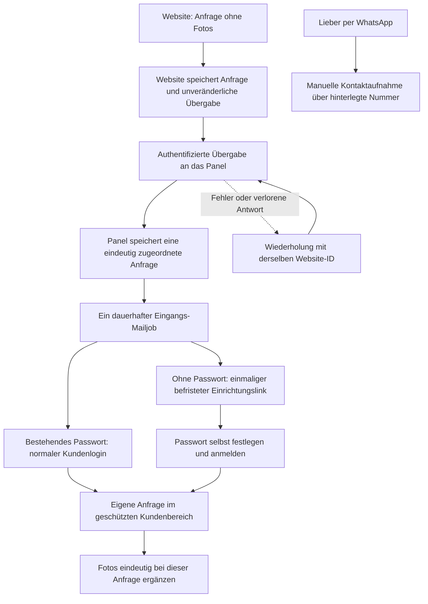

# Geprüfter Anfrage- und Zugangsablauf

WhatsApp erzeugt keine automatische Panel-Anfrage. Anfrage und Wunschtermin bleiben unverbindlich. Erst ein individuelles, freigegebenes Angebot erlaubt die vereinbarten Arbeiten.

Speicherung, Versandvormerkung, Anbieterannahme und tatsächliche Zustellung sind verschiedene Zustände. Bei einer parallelen Wiederholung kann die Antwort bereits „gespeichert“ und noch „Versand unbestätigt“ lauten, während der andere Aufruf versendet. Daraus entsteht weder eine zweite Anfrage noch ein zweiter Mailjob.

Der Einrichtungslink erlaubt zunächst nur die Passwortvergabe. Er ist kein dauerhafter Anmeldetoken und gewährt allein keinen Datenzugriff. Das Konto und sein Passwort bleiben bestehen; sichere Sitzungen laufen unabhängig davon ab. Abgelaufene Links können unter `/auth/customer?step=renew` ausdrücklich neu angefordert werden. Vorhandene Passwörter werden dabei nicht verändert.
